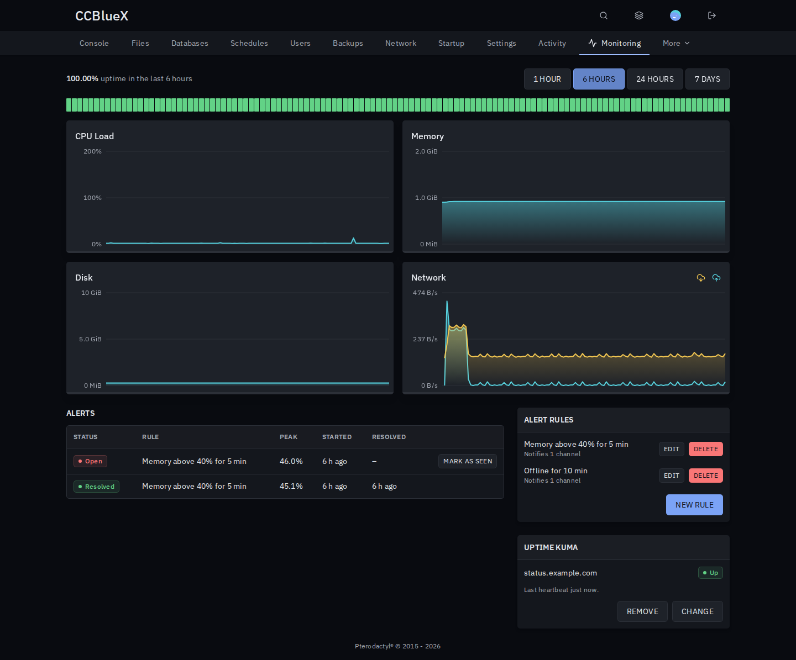
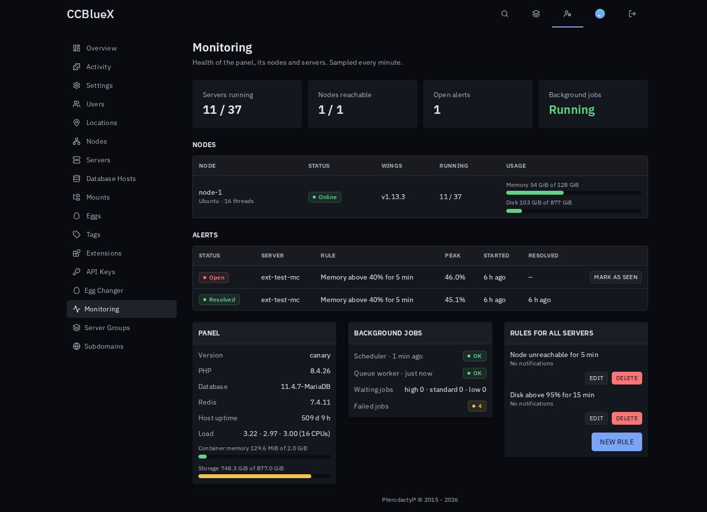

# Monitoring for Pterodactyl

Resource history, alerts and a health page for your panel, nodes and servers.

## Install

1. Download `monitoring-<version>.pteroext` from the [latest release](https://github.com/CCBlueX/Pterodactyl-Extension-Monitoring/releases/latest).
2. Install and enable it under **Admin → Extensions**.
3. Open a server's **Monitoring** tab. The first samples arrive within 5 minutes.

## Features

- **History**: CPU, memory, disk, network and uptime for up to 90 days, on each server and its admin page.
- **Alerts**: rules like "memory above 90% for 10 minutes", "server offline" or "node unreachable", with quiet periods.
- **Notifications**: Discord, Telegram, ntfy, email or any webhook, set up per user under **Account → Alerts**.
- **Health page**: nodes, background jobs and panel resources at a glance, plus a summary on the admin overview.
- **Uptime Kuma**: paste a push monitor URL and the server reports up or down every sample.

## Settings

| Setting | Default | What it does |
| --- | --- | --- |
| Sampling interval | 5 minutes | How often servers are sampled and rules are checked. |
| Keep history for | 7 days | Older samples are deleted every night. |
| Allow private targets | Off | Lets webhooks and Uptime Kuma URLs point to private networks. |

Subusers get a **Monitoring** group in the server's **Users** tab: see history and alerts, and manage rules.

---

Inspired by the Pelican plugins Resource Usage Alerts, System Status Monitor and Uptime Kuma Integration.
